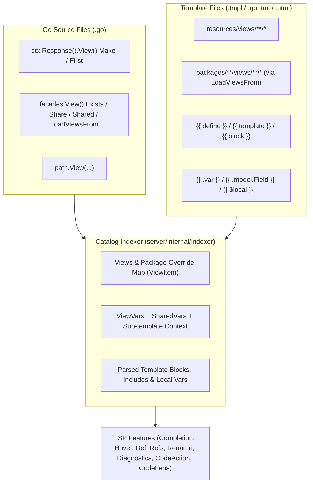

# Enhancement Plan: `facades.View` Intelligence & `.tmpl` Syntax Highlighting + LSP

This document tracks the architecture and implementation plan for enhancing `goravel-vscode-extension` across:
1. **`facades.View()` & `ctx.Response().View()` Intelligence in Go files** (`Make`, `First`, `Exists`, `LoadViewsFrom`, `Share`, `Shared`, `path.View`, package view overrides, and Quick Fix template scaffolding).
2. **`.tmpl` / `.gohtml` Syntax Highlighting & Full LSP Support** (TextMate grammar + language configuration, `{{ template }}` / `{{ define }}` / `{{ block }}` navigation, context/shared/inherited variable & nested struct field completion, local `$var` completion, template syntax diagnostics, cross-file references/rename, and template CodeLens).

---

## Architecture Overview

---

## Phase 1: `.tmpl` / `.gohtml` Language Configuration & Syntax Highlighting

1. **Language & Grammar Registration (`package.json`)**
   - Register language `goravel-tmpl` (`Go HTML Template (Goravel)`) in `contributes.languages` for `[".tmpl", ".gohtml"]` with `./language-configuration.tmpl.json`.
   - Register TextMate grammar `text.html.goravel-tmpl` in `contributes.grammars` (`./syntaxes/goravel-tmpl.tmLanguage.json`) embedding `text.html.basic`, `source.css`, `source.js`, and Go template actions.
   - Register template snippets in `contributes.snippets` (`./snippets/goravel-tmpl.code-snippets`) for `goravel-tmpl` and `html`.
2. **Language Configuration (`language-configuration.tmpl.json`)**
   - Bracket pairs & auto-closing pairs: `{{` ↔ `}}`, `{{/*` ↔ `*/}}`, `()`, `[]`, `{}`, `""`, `''`, `` ` ``.
   - Block comments: `["{{/*", "*/}}"]` and `["<!--", "-->"]`.
   - Folding markers for `{{\s*-?\s*(define|if|range|with|block)\b` → `{{\s*-?\s*end\b`.
3. **TextMate Grammar (`syntaxes/goravel-tmpl.tmLanguage.json`)**
   - Block comments `{{/* ... */}}` and `{{- /* ... */ -}}`.
   - Action delimiters `{{`, `{{-`, `}}`, `-}}`.
   - Control keywords: `define`, `template`, `block`, `if`, `else`, `range`, `with`, `end`, `nil`, `break`, `continue`.
   - Built-in functions: `and`, `or`, `not`, `len`, `index`, `printf`, `print`, `println`, `eq`, `ne`, `lt`, `le`, `gt`, `ge`, `html`, `js`, `urlquery`, `slice`, `call`.
   - Context & local variables (`.field`, `$.field`, `$var`, `:=`, `|`), string/raw-string/number/boolean literals.
   - Delegate outer content to `text.html.basic`.
4. **Client Document Selector & Watcher (`client/src/extension.ts`)**
   - Expand `documentSelector` to include `{ scheme: "file", language: "goravel-tmpl" }`, `{ scheme: "file", pattern: "**/*.{tmpl,gohtml}" }`, and `{ scheme: "file", pattern: "**/resources/views/**/*.html" }`.
   - Expand file system watcher and server `shouldReindex` to cover `packages/**/views/**/*` and `*.{tmpl,gohtml}`.

---

## Phase 2: Enhanced View Catalog & `facades.View` Indexing

1. **Richer Catalog Structures (`server/internal/indexer/schema.go`)**
   - `ViewItem`:
     - `Name string` (canonical lookup name, e.g. `"shared.tmpl"`, `"admin/index.tmpl"`)
     - `Loc Location` (active winning template location; `resources/views/` overrides package views)
     - `Source string` (`"app"` or `"package:<pkg>"`)
     - `PackageLocs []Location` (overridden or fallback package view locations registered via `LoadViewsFrom`)
     - `DefineName string` & `DefineLoc Location` (parsed from `{{ define "..." }}`)
     - `Includes []TemplateInclude` (templates included via `{{ template "..." }}` or `{{ block "..." }}`)
     - `UsedVars []string` (referenced `.var` / `$.var` names)
   - `ViewVar`:
     - `Key string`, `ValueExpr string`, `GoType string`, `Controller string`, `Shared bool`, `Loc Location`.
2. **Indexing Package Views (`LoadViewsFrom`), `First`, and `Share` (`server/internal/indexer/extras.go`)**
   - Scan Go files across `app/`, `bootstrap/`, `packages/`, `routes/`, and `tests/`:
     - Parse `facades.View().LoadViewsFrom(...)` (`path.Base(...)`, `path.Resource(...)`, `filepath.Join(...)`, or string literals) and index package view directories with app-override tracking.
     - Parse `facades.View().Share("key", val)` into `Catalog.SharedViewVars`.
     - Parse `View().Make("view", data)` and `View().First([]string{"v1", "v2"}, data)` with `GoType` inference on map values.
     - Propagate parent `ViewVars` to sub-templates included via `{{ template "sub.tmpl" . }}`.

---

## Phase 3: `facades.View` & `ResponseView` Intelligence in Go Files (`server/internal/framework/views.go`)

- Support all Go view call patterns:
  - `ctx.Response().View().Make("...", data)`
  - `ctx.Response().View().First([]string{"..."}, data)`
  - `facades.View().Exists("...")` / `mockView.Exists("...")`
  - `path.View("...")`
  - `facades.View().Share("key", val)` & `facades.View().Shared("key", ...)`
  - `facades.View().LoadViewsFrom(...)`
- Provide:
  - **Completion** of all app + package views (and shared keys in `Shared("...")`).
  - **Hover** with source (`resources/views/` vs `packages/...`), override status, `{{ define }}` name, included sub-templates, and expected variables.
  - **Go-to-Definition** to active template + package fallback locations (or `Share("key", ...)` for `Shared("key")`).
  - **Diagnostics** for missing views (aware of `LoadViewsFrom` and `First` fallback slices) and transitive unused variable hints (aware of included sub-templates).
  - **Quick Fix Code Action** to scaffold a missing `.tmpl` file in `resources/views/<name>` pre-populated with `{{ define "<name>" }}` and passed data keys.

---

## Phase 4: `.tmpl` / `.gohtml` LSP Intelligence (`server/internal/framework/views.go`, `server/internal/lsp/*`)

1. **Autocomplete (`TemplateCompletions`)**
   - Inside `{{ template "|" }}` and `{{ block "|" . }}`: suggest all indexed app/package views and `{{ define }}` names.
   - Inside `{{ .| }}` / `{{ $.| }}`: suggest controller/route `ViewVars` (direct + inherited from parent templates), global `SharedViewVars` from `View().Share(...)`, and `.csrf_token`.
   - Inside `{{ .modelVar.| }}`: suggest exported fields/relations from the inferred Go Model or Struct (`Catalog.Models` / `Catalog.Structs`).
   - Inside `{{ $| }}`: suggest local template variables (`$var := ...`, `range $i, $v := ...`, `with $x := ...`).
   - At action start / pipe `{{ | }}`: suggest Go template keywords (`define`, `template`, `block`, `if`, `else`, `range`, `with`, `end`) and built-in functions (`len`, `index`, `printf`, `eq`, `ne`, `lt`, `le`, `gt`, `ge`, `and`, `or`, `not`, `html`, `js`, `urlquery`).
2. **Hover & Go-to-Definition (`TemplateHover`, `TemplateDefinition`)**
   - Hover & jump from `.var` / `$.var` to Go `View().Make` / `First` map keys or `View().Share` calls.
   - Hover & jump from `.var.Field` to the Go struct field in `app/models` or `app/http/requests`.
   - Hover & jump from `{{ template "name" }}` / `{{ block "name" . }}` to the target `.tmpl` file.
   - Hover on `{{ define "name" }}` showing callers and parent templates.
3. **Find References & Rename (`references.go`, `rename.go`)**
   - Cross-file References & Rename (`F2`) for view variables (`.var` ↔ Go map key / `Share` key) and template names (`Make` / `First` / `Exists` ↔ `define` / `template`).
4. **Template Diagnostics, Quick Fixes & CodeLens**
   - Diagnostics for missing `{{ template "..." }}` targets (with Quick Fix to create partial), mismatched `{{ define }}` names, and unclosed `{{` or unbalanced `{{ if/range/with/define/block }}` ↔ `{{ end }}` blocks.
   - Top-of-file **CodeLens** in `.tmpl` files showing:
     - Routes / Controllers rendering the template (click to jump to Go code).
     - Parent templates including a partial via `{{ template }}`.
     - Package override relationship (`Overrides package view: ...` / `Overridden by app view: ...`).

