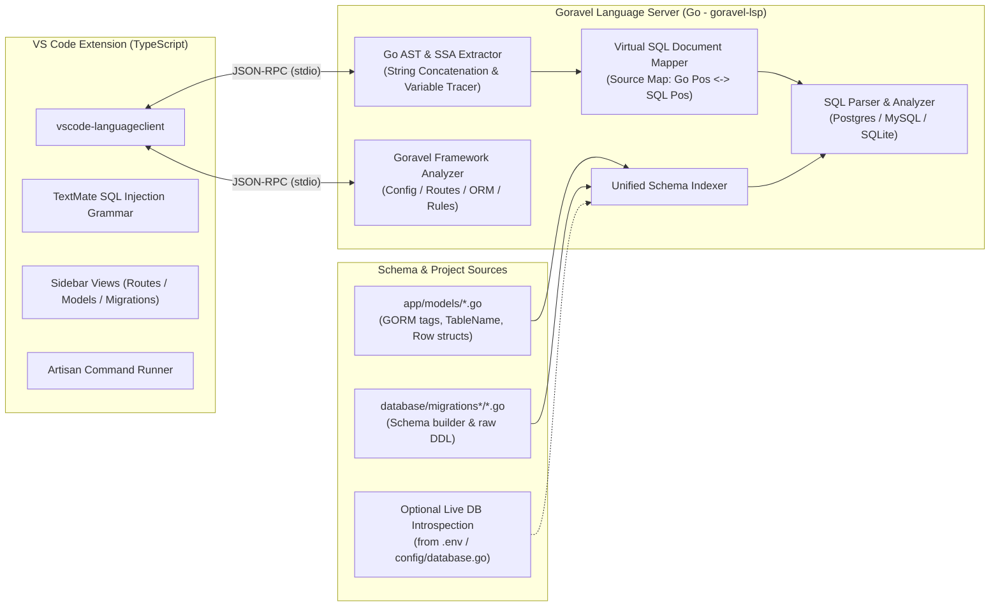

# Goravel VS Code Extension & Language Server (`goravel-vscode`) — Implementation Plan

This plan outlines the architecture and phased implementation for the **Goravel VS Code Extension**, prioritizing a **Goravel-aware Raw SQL Query LSP** as the core foundation, followed by deep framework intelligence for Models, Config, Routes, Validation Rules, and Artisan tooling.

---

## 1. Problem Statement & Core Value Proposition

In Goravel codebases (such as `basegoravel`), raw SQL queries are pervasive in repositories and migrations (`facades.DB().Select()`, `Insert()`, `Update()`, `Statement()`, `facades.Orm().Query().Raw()`), and frequently use idiomatic Go patterns that break generic SQL extensions:

```go
refGeoProvinceTableName := (models.RefGeoProvince{}).TableName(ctx)
refGeoCityTableName := (models.RefGeoCity{}).TableName(ctx)

baseMainQuery := `
    SELECT ct.id, ct.province_id, ct.name, p.name as province_name
    FROM ` + refGeoCityTableName + ` ct
    LEFT JOIN ` + refGeoProvinceTableName + ` p ON ct.province_id = p.id
    WHERE ct.deleted_at IS NULL
`
if provinceID != nil {
    where += fmt.Sprintf(" AND ct.province_id = $%d", argIndex)
}
err := facades.DB().Select(&rows, mainQuery, args)
```

Generic SQL tools cannot resolve `refGeoCityTableName` to `models.RefGeoCity` (`ref_geo_cities`), stitch concatenated Go strings (`baseMainQuery + where + fmt.Sprintf(...)`), or verify that `SELECT` columns match the target scan struct (`models.CityRow`).

---

## 2. High-Level Architecture

We will use a **Client + Go Language Server (`goravel-lsp`)** architecture so the AST parsing and type/symbol resolution leverage Go's native `go/ast`, `go/parser`, and `go/packages` ecosystems directly.



### Repository Structure (`/var/www/html/rpd/goravel-vscode-extension`)

```text
goravel-vscode-extension/
├── package.json                  # Extension manifest, grammars, commands, menus, snippets
├── tsconfig.json
├── snippets/
│   └── goravel.code-snippets     # Go boilerplate snippets (gctrl, greq, gmodel, groute, grule, gcmd, gmig, gtest)
├── syntaxes/
│   └── goravel-sql.injection.tmLanguage.json  # Embedded SQL syntax highlighting in Go
├── client/                       # TypeScript VS Code extension client
│   └── src/
│       ├── extension.ts          # Activation, LSP client bootstrap, Webview query preview, status bar
│       ├── commands/             # Artisan CLI, seeder picker, test runner, log viewer
│       └── views/                # TreeDataProviders for Models, Routes, Migrations, Commands/Seeders/Schedules
└── server/                       # Go Language Server (goravel-lsp)
    ├── go.mod
    ├── main.go
    └── internal/
        ├── lsp/                  # JSON-RPC protocol handlers & --check CLI linter
        ├── indexer/              # Workspace indexer (Models, Migrations, Config, Routes, Views, Seeders, Schedules, Live DB)
        ├── rawsql/               # Raw SQL extractor, Virtual SQL builder, SQL analyzer
        ├── orm/                  # facades.Orm() & facades.DB() call-site analyzer
        └── framework/            # Form Requests, Route/Swagger sync, Views, Model-Migration drift, Schedules
```

---

## 3. Phase 1: Raw Query LSP (Core Priority)

### 3.1. Unified Schema Indexer (Zero-Config Static Analysis + Optional Live DB)
The server builds an in-memory **Schema Catalog** (`Schema -> Table -> Columns, PKs, FKs, GoModelSymbol, MigrationLocation`) from three sources (in priority order):
1. **Go Models (`app/models/**/*.go`)**:
   - Extracts struct fields, `gorm:"..."`, `db:"..."`, and `json:"..."` tags, plus doc comments (`@Description`, `@Example`).
   - Evaluates `(Model{}).TableName(...)`, `OriginalSchemaName()`, and `OriginalTableName` constants (e.g., `RefGeoCityOriginalTableName = "ref_geo_cities"`).
   - Extracts relationships (`gorm:"foreignKey:ProvinceID;references:ID"`) to power automatic `JOIN ON` completions.
2. **Migrations (`database/migrations*/**/*.go`)**:
   - Parses both `facades.Schema().Create("table", func(table schema.Blueprint) { ... })` calls and raw DDL statements inside `facades.DB().Statement("CREATE TABLE ...")` (including dynamic table variable interpolation like ``CREATE TABLE ` + refGeoCities + ` (...)``).
   - Extracts exact SQL types (`UUID`, `VARCHAR(255)`, `DECIMAL(10,8)`), nullability (`NOT NULL`), indexes, and `FOREIGN KEY` constraints.
3. **Optional Live Database Introspection**:
   - Reads `.env` / `config/database.go` (when enabled by user setting `goravel.sql.liveIntrospection`) to query `information_schema.columns` for views, functions, or external tables (e.g., `auth.users`, `pg_publication_tables`).

### 3.2. Go AST Raw SQL Extractor & Virtual SQL Document
To handle real-world repository code (like [city_repository.go](file:///var/www/html/rpd/basegoravel/app/repositories/city_repository.go#L21-L69)), the AST extractor will:
1. **Detect SQL Sinks & Heuristics**:
   - Direct arguments or variables flowing into:
     - `facades.DB().Select(dest, query, args...)`
     - `facades.DB().Insert(query, args...)` / `Update(query, args...)` / `Delete(query, args...)` / `Statement(query)`
     - `facades.Orm().Query().Raw(query, args...)` / `Exec(query, args...)`
   - String literals assigned to variables named `*Query*` or `*SQL*`, or starting with SQL keywords (`SELECT`, `INSERT INTO`, `UPDATE`, `DELETE FROM`, `WITH`, `CREATE TABLE`, `ALTER TABLE`, `DROP TABLE`, `DO $$`).
2. **Resolve Dynamic Go Expressions Inside Concatenations**:
   - When a query is built via binary `+` expressions or `fmt.Sprintf`:
     - Trace local variables like `refGeoCityTableName` to `(models.RefGeoCity{}).TableName(ctx)` and substitute a canonical table token (`__goravel_tbl_ref_geo_cities__` mapped to `models.RefGeoCity`).
     - Trace `fmt.Sprintf(" AND ct.province_id = $%d", argIndex)` and replace `%d` / `%s` format verbs with valid SQL placeholders (`$1`) so the SQL parser can parse the full query without syntax errors.
   - Track compound variable assignments (`countQuery = baseCountQuery + where`, `where += ...`) within the same function body to understand the complete query context.
3. **Bidirectional Offset Mapping**:
   - Maintain a `RangeMap` mapping every byte offset in the synthesized **Virtual SQL string** back to the exact `file:line:column` inside the Go literal in the `.go` file.

### 3.3. Raw Query LSP Capabilities

| Capability | Behavior in `.go` Files |
| :--- | :--- |
| **Autocomplete (`textDocument/completion`)** | - **After `FROM` / `JOIN`**: Suggests table names AND in-scope Go table variables (e.g., `refGeoCityTableName`), or auto-inserts `` ` + refGeoCityTableName + ` `` when selecting a Go model!<br>- **After `<alias>.` (`ct.`)**: Suggests columns of `models.RefGeoCity` with SQL types, GORM tags, and `@Description` docs.<br>- **After `JOIN <table> <alias> ON`**: Suggests foreign key join conditions (e.g., `ct.province_id = p.id`).<br>- **In `SELECT` / `WHERE` / `ORDER BY` / `INSERT INTO (...)`**: Context-aware column and SQL function completions. |
| **Diagnostics (`textDocument/publishDiagnostics`)** | - **Unknown Table / Column**: Flags `ct.unknown_col` if `unknown_col` does not exist on `RefGeoCity` or its migration.<br>- **Scan Destination Mismatch**: In `facades.DB().Select(&rows, mainQuery, args)`, compares selected columns/aliases (`province_name`) against `models.CityRow` fields (`ProvinceName`), warning on missing struct fields or nullable columns scanned into non-pointer/non-`sql.Null*` fields.<br>- **Placeholder Count Verification**: Checks `$1..$N` or `?` counts against variadic arguments in static `Insert`/`Update`/`Select` calls.<br>- **SQL Syntax Errors**: Reports syntax errors accurately mapped back to the Go string literal. |
| **Hover (`textDocument/hover`)** | - Hovering on a column (`ct.latitude`) displays a rich Markdown card with:<br>  - Go Model field: `RefGeoCity.Latitude (*float64)`<br>  - SQL / Migration type: `DECIMAL(10, 8) NULL`<br>  - Doc comment: `@Description Latitude coordinate`<br>- Hovering on a table or alias (`ct`) shows the resolved Model, schema name, and column summary table. |
| **Go to Definition (`textDocument/definition`)** | - `Ctrl/Cmd+Click` on a column (`ct.province_id`) or table alias (`ct`) jumps directly to the field declaration in [ref_geo_city.go](file:///var/www/html/rpd/basegoravel/app/models/ref_geo_city.go#L19) (and offers Peek Definition for the `CREATE TABLE` column in [20250121000004_create_ref_geo_cities_table.go](file:///var/www/html/rpd/basegoravel/database/migrations_geo_app/20250121000004_create_ref_geo_cities_table.go#L27)). |
| **Code Actions (`textDocument/codeAction`)** | - **"Generate Row Struct from SELECT"**: Automatically generates a typed Go struct (using `uuid.UUID`, `sql.NullString`, `sql.NullFloat64`, `time.Time` based on column nullability and JOIN types—just like `models.CityRow` in [repository_rows.go](file:///var/www/html/rpd/basegoravel/app/models/repository_rows.go#L35-L48)).<br>- **"Expand `SELECT *` to explicit columns"**: Expands `*` or `ct.*` to `ct.id, ct.province_id, ...`.<br>- **"Check / Explain Query against DB"**: Runs `EXPLAIN` when live DB connection is configured. |
| **Syntax Highlighting** | - TextMate injection grammar highlights SQL keywords, functions, strings, and `$1` placeholders inside Go raw/quoted strings passed to `facades.DB()` or assigned to query variables. |

---

## 4. Phase 2: ORM & Query Builder Intelligence (`facades.Orm()` & `facades.DB().Table()`)

Even when not writing full raw SQL strings, Goravel code passes column and relation strings to query builder methods:
- **Column Completion & Validation** inside:
  - `.Where("province_id = ?", id)`, `.OrWhere(...)`
  - `.Select("id", "name")`, `.Order("created_at DESC")`, `.Group("province_id")`
  - `.Update("name", val)`, `.Pluck("id", &ids)`
- **Relation Completion & Go-to-Definition** inside:
  - `.With("Province")`, `.With("Province.Country")` — resolves struct relation fields on the inferred model type.
- **Patch Helper Awareness**:
  - Understands repository helpers like `BuildPatchQueryWithWhere(refGeoCityTableName, id, patches, false)` to suggest valid column keys in `patches` maps.

---

## 5. Phase 3: Goravel Framework Features (Config, Routes, Validation, Artisan)

### 5.1. Config & Environment Intelligence (`facades.Config()`)
- Indexes all `config/*.go` files (`config.Add("app", map[string]any{...})`) and `.env` / `.env.example`.
- **Autocomplete**: Suggests dot-notation keys inside `facades.Config().Get("...")`, `GetString("...")`, `GetInt("...")`, `GetBool("...")` (e.g., `database.connections.postgres.host`, `jwt.secret`, `supabase.url`).
- **Hover & Inlay Hints**: Shows the mapped `config/*.go` expression, `facades.Config().Env("...")` variable name, and default value.
- **Go to Definition**: Jumps from `"jwt.secret"` directly to the `"secret"` key in `config/jwt.go`.

### 5.2. Route Intelligence & Sidebar Explorer (`facades.Route()`)
- Parses `routes/*.go` and modular route packages (`routes/api_*/*.go`, `routes/web_*/*.go`), resolving nested `.Prefix(...)`, `.Middleware(...)`, and `.Group(...)` chains.
- **CodeLens on Controller Methods**: Above every controller method (e.g., `CityController.Index`), displays the resolved HTTP method and full route path (`GET /api/v1/geo/cities`) with a one-click **"Test Request"** or **"Jump to Route Definition"** action.
- **Sidebar Route Explorer**: Searchable tree view grouped by module/prefix (`api_geo_app`, `api_hris_app`, etc.).

### 5.3. Request Validation Rule Intelligence
- Provides autocomplete, hover documentation, and typo diagnostics for Goravel validation rules inside `ctx.Request().Validate(map[string]string{...})` and Form Request `Rules(ctx)` methods (including custom rules registered from `app/rules/*.go`).

### 5.4. Artisan CLI & Migration Explorer
- VS Code Command Palette integration for `artisan make:model`, `make:controller`, `make:migration`, `make:seeder`, `make:rule`, `migrate`, `migrate:rollback`, and `db:seed --seeder=...`.
- **Multi-Folder Migration Explorer**: Supports both standard `database/migrations` and modular migration directories (`database/migrations_geo_app`, `database/migrations_hris_app`, etc. as used in `basegoravel`), with quick navigation between a Model and its corresponding Migrations.

### 5.5. Deep Framework, Views, Drift & DX Tooling (Phase 4)
- **Form Request ↔ `Rules(ctx)` Sync (`app/http/requests/*.go`)**: Key completions, unknown-key diagnostics, and a *"Generate `Rules(ctx)` entries from struct fields"* Code Action inside `Rules(ctx)`, `Messages(ctx)`, and `Attributes(ctx)`.
- **Route Params, Middleware & Swagger Sync**:
  - Validates `ctx.Request().Route(...)` / `RouteInt` / `RouteInt64` against registered route `{param}` placeholders.
  - Checks `@Router`, `@Param`, and `@Success` Swagger annotations against `facades.Route()` and indexed structs, with a Code Action to generate Swagger comments.
  - Controller method hover shows route paths and inherited `.Middleware(...)` stacks; middleware names in `routes/` jump to `app/http/middleware/*.go`.
  - *"Test Request"* CodeLens pre-fills JSON payloads from the controller's bound `requests.*Request` struct (`goravel/routeSample`).
- **Views & Templates (`resources/views/**/*.tmpl`)**: Completion, hover, Go-to-Definition, missing-template diagnostics, and unused data-key hints on `View().Make(...)`.
- **Model ↔ Migration Drift & Bootstrap Checks**: Warns on missing migration columns in models (with a Code Action to add them), model fields absent from migrations, and unregistered migrations/seeders/rules/commands not wired into `bootstrap/`.
- **Schedules, SQL Index Hints & Live Query Preview**:
  - Human-readable `.Cron("...")` Inlay Hints and Hover cards, plus a **Commands, Seeders & Schedules** sidebar explorer.
  - Hint diagnostics when `WHERE`/`ON` filters on unindexed columns of indexed tables.
  - Read-only `SELECT` **Preview Query Results** Webview table (`goravel/previewQuery`, capped at 20 rows).
- **Testing, Logs, Context Menus & Snippets**: `Test*` CodeLenses in `tests/**/*_test.go` (auto-using `APP_ENV=testing` when `.env.testing` exists), `goravel.logs.open` for `storage/logs/goravel.log`, Explorer right-click `make:*` context menus, and Go snippets (`snippets/goravel.code-snippets`).

---

## 6. Step-by-Step Execution Roadmap

### Milestone 1: Extension & LSP Scaffolding
1. Initialize the VS Code extension (`package.json`, `tsconfig.json`, `esbuild` bundler) in `/var/www/html/rpd/goravel-vscode-extension`.
2. Add the TextMate SQL Injection grammar (`syntaxes/goravel-sql.injection.tmLanguage.json`) so raw SQL strings in Go get immediate syntax highlighting.
3. Initialize the Go LSP server (`server/go.mod`, JSON-RPC transport over stdio, document sync `textDocument/didOpen`, `didChange`, `didSave`).

### Milestone 2: Schema Indexer (`app/models` & `database/migrations*`)
1. Implement the Go AST parser for `app/models/*.go` to index structs, GORM/JSON tags, `TableName()` methods, `OriginalTableName` constants, and `Row` scan structs.
2. Implement the migration parser for `database/migrations*/**/*.go` to index `CREATE TABLE` DDL statements and `facades.Schema()` blueprints.
3. Add file-watcher incremental re-indexing when model or migration files change.

### Milestone 3: Virtual SQL Builder & Raw Query LSP Features
1. Build the Go AST SQL sink detector (`facades.DB().Select/Insert/Update/Delete/Statement`, `facades.Orm().Query().Raw`, `*Query` variables) and string concatenation stitcher with bidirectional `RangeMap`.
2. Implement SQL lexer/parser (supporting PostgreSQL `$1` and MySQL `?` dialects, `ILIKE`, CTEs, `LEFT JOIN`, aliases).
3. Wire up **Completion** (`FROM`/`JOIN` tables & Go variables, `alias.column`, `JOIN ON` foreign keys).
4. Wire up **Hover** and **Go to Definition** (jumping from SQL column/table to Go Model field or Migration line).
5. Wire up **Diagnostics** (unknown column/table, `Select(&rows, ...)` scan struct field/nullability validation, parameter count mismatch) and **Code Actions** (Generate `*Row` struct from `SELECT`).

### Milestone 4: ORM, Config, Routes & Artisan Tooling
1. Add `facades.Orm().Query()` / `facades.DB().Table()` string argument completions and diagnostics.
2. Add `facades.Config()` key indexer, completion, hover, and Go-to-Definition.
3. Add Route indexer, Controller CodeLenses, and Sidebar TreeViews (Routes, Models, Migrations).

### Milestone 5: Deep Framework, Views, Drift & DX Tooling
1. Add Form Request `Rules(ctx)`/`Messages(ctx)`/`Attributes(ctx)` struct sync, Route `{param}` & Swagger `@Router` validation, Middleware hover/definition, and `.http` sample body generation.
2. Add View template (`resources/views`) intelligence, Model ↔ Migration drift diagnostics/actions, and `bootstrap/` registration checks.
3. Add Schedule `.Cron()` inlay hints, SQL index hints, read-only Live DB query preview Webview, Test runner CodeLenses, `Commands, Seeders & Schedules` TreeView, Explorer context menus, and Go snippets.

---

## 7. Verification Plan

1. **Unit Tests (`server/internal/...`)**:
   - Test `rawsql` extraction and `RangeMap` offset mapping against real snippets from `basegoravel/app/repositories/city_repository.go` and `basegoravel/database/migrations_geo_app/20250121000004_create_ref_geo_cities_table.go`.
   - Verify table variable resolution (`refGeoCityTableName` -> `models.RefGeoCity` -> `ref_geo_cities`) and `fmt.Sprintf(" AND ct.province_id = $%d", argIndex)` normalization.
   - Verify scan-struct validation between `baseMainQuery` and `models.CityRow`.
2. **End-to-End LSP Integration Tests**:
   - Launch `goravel-lsp` against `/var/www/html/rpd/basegoravel` and assert completion items at `ct.|` in `city_repository.go:33`, hover info on `ct.latitude`, and definition jump to `app/models/ref_geo_city.go`.
3. **VS Code Extension Host Smoke Test**:
   - Compile the extension and verify SQL syntax injection, status bar schema count, and responsiveness (<50ms completion latency).
